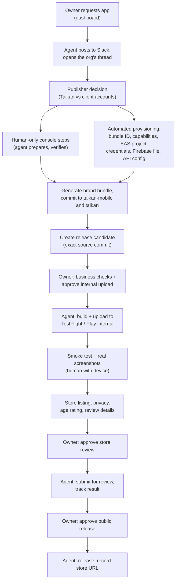

# mobile: Taikan's mobile team lead

> **Status: plan for review, 2026-10-16.** Nothing below beyond "What exists"
> is built. Agent startup defaults off; read [cost controls](COST-CONTROLS.md)
> before any activation.

`mobile` owns the mobile release flow for Taikan's own app (`fit.taikan.app`) and
for every gym's branded member app, end to end, and is accountable for its
outcome. Slack is where it reports and where people talk to it. It replaces the
`release` bot and the GitHub Actions executor `brand-build.yml`.

People keep three things:

- **Gym owners** approve in the dashboard. The Taikan API enforces every owner
  approval; the agent can never create, extend, or bypass one.
- **Store-console steps with no API** (listed under
  [Human-only steps](#human-only-steps)). The agent prepares them, asks the
  named person, verifies completion through an API, and chases until done.
- **Saar** decides policy questions (publisher account, risk), and anything the
  agent escalates.

## What exists

| Piece | Where | State |
|---|---|---|
| `mobile` agent v1: Taikan app build/OTA dispatch, App Store and Play production releases | `souls/mobile.md`, `config/mobile.yaml`, `scripts/mobile-client.py`, `fastlane/Fastfile` | Built and tested offline; uncommitted; not deployed |
| `release` bot: list, preflight, and nudge owner-approved branded uploads | `souls/release.md`, `scripts/release-client.py` | Built; not deployed |
| Branded executor: the API dispatches `brand-build.yml`, which proves itself with a GitHub OIDC token, builds, asks the API to authorize submit, uploads | taikan `apps/api/src/organizations/branded-app-*.ts`, taikan-mobile `.github/workflows/brand-build.yml`, `scripts/brand-build.mjs` | Built; never run |
| Owner tracker, approvals, operator admin routes | taikan `branded-app-release.service.ts`, `admin-branded-apps.controller.ts`, `apps/admin/.../branded-app-panel.tsx` | `member-app-release-tracker` on for 100% |
| Flags `member-app-internal-upload-assistance`, `member-app-hermes-assistance` | PostHog, created 2026-10-16 | Off, never evaluated |

No branded app has been provisioned: taikan-mobile's `brands/registry.json` is
`{}` and `eas.json` has no `production-brand-*` profiles.

## Responsibilities

### Taikan's app

1. **Builds and OTA.** Production builds with store upload, and OTA updates,
   through EAS Workflows (moved off GitHub Actions; see
   [Execution](#execution-eas-workflows-not-github-actions)).
2. **Store releases.** Submit for App Review with automatic release on
   approval; promote Play internal to production at 100%. This is what v1's
   fastlane lanes do.
3. **Release judgment.** Before an OTA, decide whether `main` needs a build
   instead (native changes, version bump). Use EAS `fingerprint` and `get-build`
   jobs rather than asking a person.
4. **Version bumps.** A native version bump invalidates every branded app:
   `applyBrand` throws when `brand.nativeVersion` differs from the app version
   (taikan-mobile `scripts/brand-config.cjs`). The agent plans the fan-out:
   regenerate each brand, new candidates, owner approvals.

### Branded apps

Every step is recorded in the Taikan API, so the owner's tracker stays the
source of truth. The agent posts each step in the org's Slack thread.

## Capability map

Checked 2026-10-16 against Apple, Google, and Expo docs and the eas-cli source.

| Step | How the agent does it |
|---|---|
| EAS project per gym | `eas init --account saarku --non-interactive` |
| iOS bundle ID and capabilities (Associated Domains, Push) | App Store Connect API `POST /v1/bundleIds`, `/v1/bundleIdCapabilities` |
| iOS provisioning profile | EAS creates or repairs it with an App Store Connect key once a distribution cert is assigned |
| Android upload keystore | `eas build --non-interactive` generates it |
| Store listing, screenshots, age rating, review details and demo account (iOS) | App Store Connect API |
| Store listing, images, testers, tracks, staged rollout (Play) | Play Developer API `edits.*` |
| Play Data Safety | `POST /applications/{pkg}/dataSafety` (CSV), after the first fill in Console |
| Builds, uploads, OTA, TestFlight groups | EAS Workflows jobs `build`, `submit`, `update`, `testflight` |
| Firebase Android app and `google-services.json` | Firebase Management API `projects.androidApps.create`, then `getConfig` returns the file (base64) |
| App Review submission and release | App Store Connect API review submissions and release requests (v1 fastlane lanes) |
| Play production release | Play API `edits.tracks` (v1 fastlane lane) |

### Human-only steps

| Step | Why | Agent's part |
|---|---|---|
| Expo robot user and token; App Store Connect API key; Play service account invite | Created in each vendor's UI by an admin | One-time setup per account, listed in the runbook |
| App Store Connect app record | Apple: "Don't use this API to create new apps." `fastlane produce` works only with an Apple ID session that needs 2FA renewal about monthly | Posts name, bundle ID, SKU, language; detects the record through the API; stores `ascAppId` |
| App Privacy questionnaire (iOS) | Not in the official API; fastlane's path needs an Apple ID session | Posts the answers from the owner's intake; verifies at submission |
| Play Console app creation, first release, content rating questionnaire, first Data Safety fill | No API; Google requires the first release in Console | Posts the checklist and the built AAB; verifies through the Play API |
| Play closed test before production (while the Play account stays personal) | Personal-account rule: 12 testers opted in continuously for 14 days, then a production-access application reviewed by Google | Runs the test track and tester Google Group through `edits.testers`, counts each tester's continuous days, reminds testers who are about to lapse, drafts the application answers for a person to submit |
| First iOS distribution certificate for a new EAS project | eas-cli source: the non-interactive path throws `MissingCredentialsNonInteractiveError` when the app has no cert; reusing the team's existing cert is offered only in the interactive path | One interactive `eas credentials` run per new app (reuse the team cert), or the client calls the same Expo GraphQL mutation the CLI uses (undocumented) |
| Linking the GitHub repo to EAS projects | Dashboard-only. Expo: "You can only link GitHub organization repositories to Expo organizations"; Taikan's projects live in the personal account `saarku`, which has no organization | Needs an Expo organization first (see [Decisions](#decisions-for-saar)); then one link per project. Without a link, `eas workflow:run` uploads a local checkout instead |
| Device smoke test and real-device screenshots | Physical device | Posts the exact build to install and the capture checklist; records evidence after upload |

## Architecture

### The agent and its client

The LLM decides, explains, and communicates. A deterministic client enforces
every invariant: `scripts/mobile-client.py` grows into the only path to EAS,
App Store Connect, Play, and the Taikan API. It keeps v1's patterns: argument
allowlists, idempotency guards, "effect unknown, check status" on timeouts, no
raw logs or secrets in output.

### Execution: EAS Workflows, not GitHub Actions

- **Taikan app:** `.eas/workflows/store-build.yml` and `ota.yml` in
  taikan-mobile, dispatched with `POST https://api.expo.dev/v2/workflows/dispatch`.
  The Sentry source-map upload for OTA becomes a custom step using
  `SENTRY_AUTH_TOKEN` stored as an EAS secret.
- **Branded apps:** the agent becomes the executor; EAS does the work. The agent
  calls the API handshake itself instead of a GitHub runner:
  1. claim the operation and fetch its immutable input (exact source commit,
     snapshot, signed asset URLs);
  2. check the pre-build invariants `brand-build.mjs` checks today: file digests
     at that commit (`eas.json`, `pnpm-lock.yaml`, `brand.json`, assets,
     `google-services.json`), identity fields, submit profile Android
     `internal`/`draft`/`changesNotSentForReview`;
  3. dispatch a build workflow at `gitRef` = that commit;
  4. on the EAS build event, verify provenance: one `FINISHED` build, matching
     `gitCommitHash`, `appIdentifier`, project ID, build number; hash the
     artifact; report `build_finished`;
  5. call `authorize-submit` (the API rechecks the owner approval and the
     lease), then dispatch the submit job for that exact build ID;
  6. on the EAS submit event, confirm exactly one matching `FINISHED` submission
     and report `upload_finished`;
  7. after submit has started, any failure is `unknown` and goes to
     reconciliation, never an automatic retry.

  No GitHub runner waits on a build, and the GitHub OIDC trust path goes away.

### Events in, Slack out

The agent never polls; cron stays off fleet-wide. Inputs arrive as signed
webhooks on Hermes routes (see [WEBHOOKS.md](WEBHOOKS.md)):

| Source | Events | Delivery |
|---|---|---|
| Taikan API (new outbox job) | `setup_request`, `submission_saved`, approvals and revocations, `internal_upload` requested, invalidations, owner cancellation | `X-Webhook-Signature-V2` signed POST, plus a catch-up feed by event `sequence` |
| EAS | BUILD, SUBMIT (no workflow-run event exists) | EAS signs `expo-signature: sha1=…`, which Hermes rejects. Either a shim that re-signs (as planned for Sentry), or a final custom job in each workflow that posts a V2-signed summary |
| App Store Connect | Build processing, review state | ASC webhooks (`POST /v1/webhooks`) through the same shim, or status checks on request |

Slack:

- one thread per gym request or release, plus one for Taikan app releases;
- every step gets a one-line status;
- failures, "unknown, needs reconciliation", and human-only tasks mention the
  owner of the next step;
- routes pick the channel with `deliver_extra.chat_id` and the thread with
  `deliver_extra.thread_id`, which the pinned Hermes passes to Slack as
  `thread_ts`. The route has to know the thread's parent `ts`: the agent keeps
  one per request or release, and a route `script` injects it.

Plain status lines use `deliver_only` (no model run). Events that need a
decision run the agent.

### Changes per repo

**taikan API**

- An agent principal with scoped access to the operator routes it needs:
  config, verify provisioning, runtime access, create release, operator
  evidence, store actions, reconcile. Operator routes accept only a human Clerk
  session with `platformRole: admin` today. Extend the existing assistant
  token guard (SHA-256 token + org allowlist) rather than giving the agent a
  Clerk admin user.
- Executor handshake for the agent: claim, input, events, heartbeat, and
  `authorize-submit` accept the agent principal; the lease binds to the agent
  instead of a GitHub run; actor kind `hermes` (already allowed by the DB
  CHECK). Delete the GitHub dispatch in `branded-app-release.outbox.ts`, the
  OIDC exchange, and the `github_run_id` binding.
- Outbox notifications to the agent's webhook, plus an event feed endpoint.
- Missing routes: set request `configuring`/`blocked` with a blocker code;
  operator cancel (the service already supports `platform_operator`).
- Unchanged: owner-only `approve`, `revoke`, and owner business checks.
  `authorize-submit` keeps rechecking the approval.

**taikan-mobile**

- `.eas/workflows/`: Taikan store build, OTA, brand build, brand submit.
- EAS webhooks for each project, Taikan's and each gym's.
- Delete `brand-build.yml` and the GitHub OIDC parts of `brand-build.mjs`
  once the agent path is proven.

**taikan-agents**

- Client commands for EAS (projects, workflows, credentials checks, builds,
  submissions), App Store Connect provisioning, Play setup, and the Taikan API.
- Hermes webhook routes and their toolsets (webhook runs get a restricted
  toolset by default).
- Soul: the team-lead role, both flows, approval invariants, Slack conventions.
- Retire `release`: its soul, config, client, and entrypoint branch.

### Credentials

| Credential | Scope | Notes |
|---|---|---|
| Expo robot token | Account `saarku`, Developer role | Minimum role for workflow dispatch is unverified |
| App Store Connect Team key | Admin, or App Manager with certificate access, to create certs and profiles | Spans every app on the team, including branded apps under Taikan's account |
| Play service account | Per-app grants: release to production and testing tracks, app information | Invited per app after a human creates the app |
| Taikan API agent token | Operator routes listed above, executor handshake, org allowlist | Replaces `TAIKAN_RELEASE_ASSISTANT_TOKEN` |
| GitHub token | Contents and pull requests on taikan-mobile and taikan | Commits generated brand bundles and `.well-known` files. Repository access, not Actions; PR CI still uses Actions minutes |
| Client-owned publisher accounts | Per client | Clients delegate roles to the agent's keys; never passwords (branded-app submission runbook) |

The agent's terminal can read all of these. Before adding more, consider moving
store and Expo calls behind a supervisor-held proxy, the way `cost_guard.py`
holds the Anthropic key.

### Model and cost

- Main model **Sonnet 5**: the role now includes provisioning decisions,
  incident judgment, and Hebrew/English/Russian store copy. Haiku 4.5 remains
  for compression and for webhook routes that only format status (Hermes
  profiles per route).
- Limits stay within the fleet maxima in `scripts/runtime_policy.py`. Each
  release is a handful of event-driven runs.
- EAS: build jobs cost the same as today; other jobs $0.018/min on Linux medium.
  The Free plan's 60 CI minutes would not cover branded apps.

## Risks

- **Store policy.** Many near-identical apps under Taikan's own accounts risk
  rejection and account-level enforcement (`docs/architecture/brand.md:411`).
  The agent records `publisherKind` per gym and raises the risk at intake.
- **Play production access for new apps.** `fit.taikan.app` is live on both
  stores (Play listing returns 200; App Store lookup returns version 1.0.8,
  id 6804224474; checked 2026-10-18). It went through Google's personal-account
  rule: a closed test with 12 testers opted in continuously for 14 days, then a
  production-access review
  ([Play help 14151465](https://support.google.com/googleplay/android-developer/answer/14151465)).
  The page words the rule per app ("before those apps are eligible"), which
  suggests each branded app on this personal account would need its own
  test [inferred from wording; confirm with Play support]. The page covers
  only personal accounts. Both store accounts are individual: the seller is
  "Saar Kuriel" on the App Store lookup and the Play listing. Fix: convert
  both to a Desmotech organization with one D-U-N-S number (free from D&B;
  Apple says allow up to 5 business days). Play has a documented in-place
  conversion (Developer account → About you → verify the organization
  website → Change account type → organization payments profile with the
  D-U-N-S → verification → link; wait 72 hours before submitting new apps;
  [Play help 16260648](https://support.google.com/googleplay/android-developer/answer/16260648)).
  Apple converts an individual membership on request, given the D-U-N-S and
  possibly business documents
  ([Apple help](https://developer.apple.com/help/account/membership/updating-your-account-information)).
  That new apps then skip the closed test follows from the testing page
  covering only personal accounts and a 2026 community answer
  [not stated by Google]. Deferred on 2026-10-18: the accounts stay
  individual for now, so the branded flow includes the closed test until the
  conversion happens.
- **Branded OTA.** Each gym has its own EAS project, so a Taikan OTA does not
  reach branded apps. Nothing documents the branded update flow yet; it needs a
  design before the first branded app ships.
- **Credential breadth** (see above).
- **One agent, many writes.** A soul is not a control. Owner approvals,
  `authorize-submit`, and the client's allowlists are the controls.

## Phases

Each phase ends with a demo in Slack.

1. **Ship v1.** Commit the existing `mobile` agent; deploy for Taikan's app with
   the GitHub dispatch it has.
2. **Taikan app on EAS Workflows.** Workflow files, Expo robot token, client
   switch, EAS webhooks to Slack. Remove the agent's GitHub Actions dependency.
3. **Intake and visibility.** API outbox webhooks and event feed; agent token
   with read access; Slack thread on every branded-app request.
4. **Provisioning.** Bundle IDs, capabilities, EAS projects, credentials,
   generator run, commits, API config, human-only task tracking. Pilot one gym
   end to end up to an owner-approved candidate.
5. **Agent executor.** API handshake changes, branded build and submit
   workflows, provenance checks. Pilot internal upload for the same gym with
   `member-app-internal-upload-assistance` on for that gym only.
6. **Store review and release for branded apps.** Listing, disclosures, review
   submission, public release, all behind owner approvals.
7. **Cutover.** Delete `brand-build.yml`, the OIDC exchange, and the `release`
   bot. Retire `member-app-hermes-assistance`;
   `member-app-internal-upload-assistance` stays as the per-gym switch for
   agent uploads.

## Verify first

Settled on 2026-10-17 from source and docs:

- **iOS certificate for a new app:** cannot be assigned non-interactively
  through the CLI (eas-cli `SetUpDistributionCertificate.ts`). One interactive
  run per new app, or the undocumented GraphQL path.
- **GitHub link:** requires an Expo organization; `saarku` is a personal
  account with none (`eas account:view`).
- **Slack threads:** supported by the pinned Hermes (`webhook.py`
  `_deliver_cross_platform` → Slack adapter `_resolve_thread_ts`).
- **Firebase:** automatable through the Firebase Management API.

Still open:

1. Which Expo robot role may dispatch workflows and submit? The docs give
   Developer "create new projects, make new builds, release updates, and
   manage credentials" but say nothing about workflows. Needs a robot token
   and one dispatch.
2. Can one GitHub repo link to many EAS projects (one per gym)? Needs the
   organization and a second project.
3. Does each new app on Taikan's personal Play account need its own 14-day
   closed test? Ask Play support; the answer decides whether branded apps need
   the organization account.
4. End-to-end dry run on a throwaway slug: create the EAS project, register a
   bundle ID, assign the team certificate, build, delete.

## Decisions for Saar

1. Publisher default for gyms: Taikan's accounts, or client-owned?
2. Apple app records: a person creates them, or accept an Apple ID session
   for `fastlane produce` with monthly 2FA renewal?
3. Generated brand bundles: the agent merges its own commits, or opens PRs for
   a person to merge?
4. Slack channel for mobile releases.
5. Expo organization: convert `saarku` in place (Expo says updates, push
   notifications, stored credentials, webhooks, and the subscription keep
   working), or create a new organization and transfer projects (transfers are
   limited in number)?
